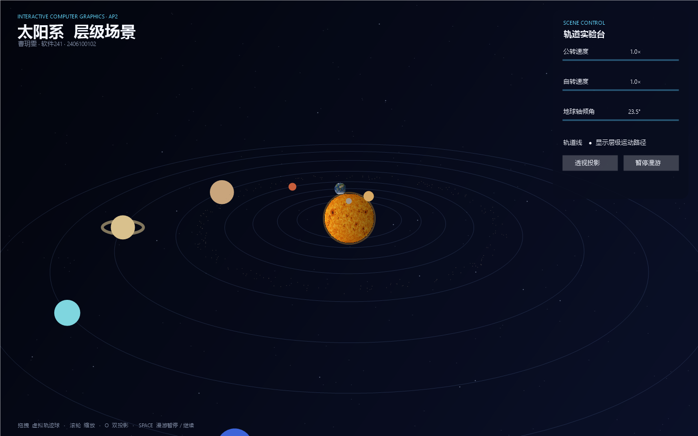
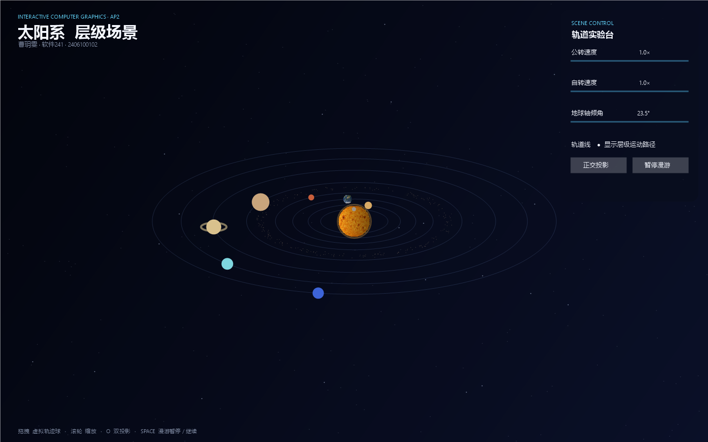

# AP2 · 三维层级场景：太阳系

曹玥雯 · 软件241 · 2406100102

本项目由曹玥雯独立完成，代码仓库不包含共同作者署名。

原生 WebGL 2.0 实现的太阳系层级场景。项目完成太阳—地球—月球三级矩阵嵌套、手工矩阵组合、三张位图纹理、正交/透视双投影、预设相机漫游、虚拟轨迹球和参数面板，并扩展到八大行星、土星环与小行星带。

## 运行

公网地址：[https://shirleyvale.github.io/ap2-solar-system/](https://shirleyvale.github.io/ap2-solar-system/)

本地运行无需安装依赖。在项目根目录执行：

```powershell
node 源码/scripts/serve.mjs 源码/dist 4173
```


## 交互

- `O`：在透视投影与正交投影之间切换。
- `空格`：暂停/继续预设相机漫游；手动拖拽后按空格可恢复漫游。
- 鼠标拖拽：虚拟轨迹球控制视角；拖拽会立即接管自动漫游。
- 鼠标滚轮：手动视角下拉近/拉远。
- `R`：重置相机、漫游进度和食相观察位。
- 参数面板：调节公转速度、自转速度、地球轴倾角；开关轨道线。
- 食相观察位：日食模式强制“太阳—月球—地球”共线，月食模式强制“太阳—地球—月球”共线，用于观察几何次序。

## 层级结构图

```text
SolarSystemRoot (世界坐标)
├─ Sun
│  └─ R_y(太阳自转) · S(太阳半径)
├─ Mercury / Venus / Mars / Jupiter / Uranus / Neptune
│  └─ R_y(公转) · T(轨道半径) · R_z(轴倾角) · R_y(自转) · S(半径)
├─ Saturn
│  ├─ SaturnBody
│  └─ SaturnRing（共享土星公转父节点与轴倾角）
├─ AsteroidBelt（确定性随机点集）
└─ EarthOrbitFrame = R_y(地球公转) · T(日地距离)
   ├─ EarthBody = R_z(23.5°) · R_y(地球自转) · S(地球半径)
   └─ MoonOrbitFrame = R_z(5.14°) · R_y(月球公转) · T(地月距离)
      └─ MoonBody = R_y(月球自转) · S(月球半径)
```

矩阵采用列向量约定，写作 `M_world = M_parent · M_local`。因此地球最终模型矩阵为：

```text
M_earth = R_y(orbit) · T(distance) · R_z(tilt) · R_y(spin) · S(radius)
```

右侧的局部变换先作用：球体先缩放、绕自身轴自转、再施加轴倾角，最后才挂到公转父节点。这样改变地球的 23.5° 倾角不会误改公转轨道，满足“先转后挂”的要求。对应实现位于 `dist/js/app.js` 的 `drawScene()`。

## 手动矩阵：月球轨道面倾角

月球轨道倾角没有使用封装好的场景图或复合变换函数，而是显式创建三张 `MV.js` 基本矩阵后用 `mult` 组合：

```javascript
const moonTiltMatrix = rotateZ(moon.inclination);
const moonRevolutionMatrix = rotateY(moonAngle);
const moonOffsetMatrix = translate(moon.distance, 0, 0);
const moonOrbitMatrix = mult(
  moonTiltMatrix,
  mult(moonRevolutionMatrix, moonOffsetMatrix)
);
const moonFrame = mult(earthOrbitFrame, moonOrbitMatrix);
```

其数学形式为：

```text
M_moon = M_earthOrbit · R_z(5.14°) · R_y(θ_moon) · T(d_moon)
```

先把月球移到地月距离 `d_moon`，再绕地球公转，随后把整个轨道面倾斜 5.14°，最后乘上地球的公转父矩阵。月球因此跟随地球移动，但不会继承地球本体的自转或 23.5° 轴倾角。

## 纹理与 UV 翻转

太阳、地球和月球使用项目内的 2:1 equirectangular PNG 位图：

```text
dist/textures/sun.png
dist/textures/earth.png
dist/textures/moon.png
```

三张纹理由 ImageGen 为本项目生成，未依赖网络外链。程序为 UV 球生成 `aTexCoord`，再在 `loadBitmapTexture()` 中执行：

```javascript
gl.pixelStorei(gl.UNPACK_FLIP_Y_WEBGL, true);
gl.texImage2D(gl.TEXTURE_2D, 0, gl.RGBA, gl.RGBA, gl.UNSIGNED_BYTE, image);
gl.pixelStorei(gl.UNPACK_FLIP_Y_WEBGL, false);
```

普通图片像素行从左上角开始，而 WebGL 纹理坐标以左下角为原点；如果不翻转，地球南北会倒置。上传前三者统一开启 `UNPACK_FLIP_Y_WEBGL`，上传后立即恢复，避免影响后续用 Canvas 生成的行星纹理。

## 双投影对比

两张图使用同一时刻、同一组天体参数和同一相机位；只替换投影矩阵。

| 透视投影 | 正交投影 |
|---|---|
|  |  |

- 透视投影由 `perspective(43°, aspect, 0.1, 120)` 构造，远处天体与轨道明显缩小，具有“近大远小”和汇聚感。
- 正交投影由 `ortho(...)` 构造，物体投影尺寸不随深度变化，平行方向保持平行，更适合比较轨道相对尺度。
- 截图可以由 `源码/scripts/render-deliverables.ps1` 重新生成；脚本复用与 WebGL 场景一致的半径、轨道距离和相机数学，保证对比条件一致。

## 相机漫游与虚拟轨迹球

自动漫游使用 6 个相机关键帧，每段 4.8 秒。关键帧之间使用 `smoothstep(t) = t²(3−2t)` 插值，以避免线性插值在节点处突然变速。按空格只暂停相机路径，天体仍持续运动。

虚拟轨迹球将指针位置映射到单位半球，前后两点通过叉积与点积构造增量四元数，再累乘到相机方向。它不是简单的二维平移：靠近画布边缘拖拽会产生明显的空间旋转。

10 秒演示文件：[`源码/demo/camera-tour-10s.gif`](源码/demo/camera-tour-10s.gif)（100 帧 × 0.1 秒）。

## 扩展功能

- E1：八大行星，含土星环与 520 个小行星组成的小行星带。
- E2 辅助展示：日食/月食共线观察位与说明面板，用于解释三者的遮挡次序（未实现物理精确的半影积分）。
- E3：基于单位半球映射和四元数累乘的虚拟轨迹球。

## 参数集中配置

所有天体半径、轨道距离、公转/自转周期、轴倾角、颜色和纹理路径均集中在 `dist/js/config.js` 的 `SOLAR_CONFIG` 中。为了在单个课堂画面中同时看到太阳与海王星，半径与距离采用可视化压缩比例；周期保留真实的相对快慢顺序，但动画速度经过统一放大。

## 文件结构

```text
源码/
  dist/
  Common/
    MV.js                 矩阵、观察与投影函数
    initShaders.js        着色器编译/链接
    webgl-utils.js        WebGL 2.0 与画布缩放
  js/
    config.js             天体参数与相机关键帧
    geometry.js           UV 球、环、轨道、小行星几何
    trackball.js          四元数虚拟轨迹球
    app.js                渲染、层级矩阵、纹理、UI 事件
    textures/             太阳、地球、月球 PNG
    index.html
    style.css
  screenshots/            双投影对比图
  demo/                   10 秒漫游动画
  scripts/
    serve.mjs             零依赖静态服务器
    render-deliverables.ps1 演示材料复现脚本
  tests/check.mjs          矩阵/层级/投影/几何自动检查
index.html                 GitHub Pages 入口
```

## 自检

```powershell
node 源码/tests/check.mjs
node --check 源码/dist/js/app.js
```

预期输出：`AP2 matrix, hierarchy, projection and geometry checks: PASS`。

## 代码与素材来源

- 实现思路依据课程教材 Angel & Shreiner, *Interactive Computer Graphics*, 8th ed. 的变换、观察与投影章节。
- `Common/` 为本项目按教材 API 风格独立实现的最小工具集；其余 JavaScript、着色器、轨迹球与演示脚本均为本项目代码。
- 太阳、地球、月球纹理按照本项目的 equirectangular 纹理规范独立生成，并随源码分发。
